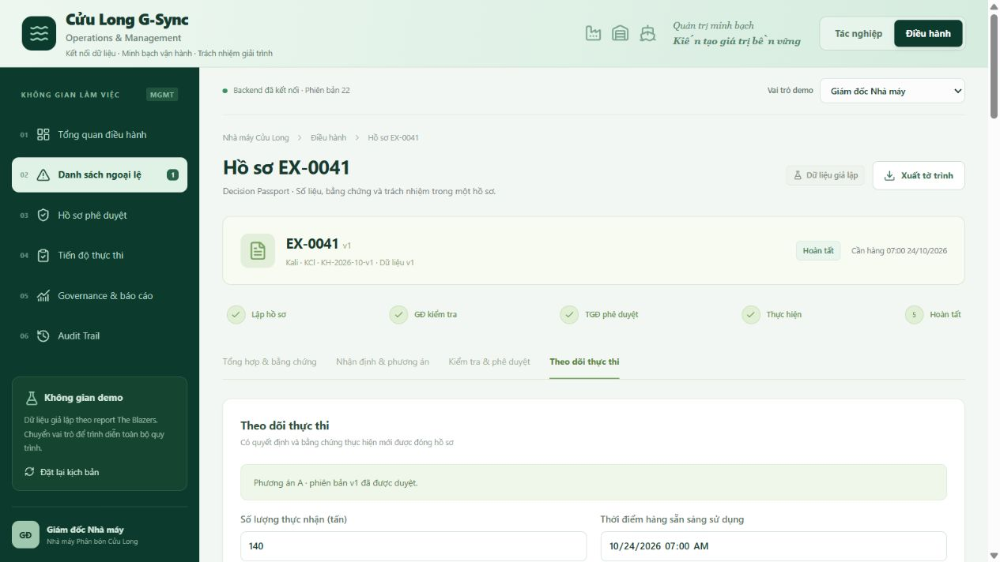

# Cửu Long G-Sync

App web demo có frontend, backend, database và lưu chứng từ, dựa trên report **The Blazers – Cửu Long G-Sync**. Giao diện lấy định hướng từ HTML portal xanh do nhóm cung cấp. Toàn bộ dữ liệu mẫu là giả lập, không phải dữ liệu vận hành nhà máy.



## Hướng dẫn chạy app

### Chạy lại app sau khi đã cài đặt

Dành cho các thành viên đã clone repo, cài thư viện và chạy `setup` thành công. Nếu app đang chạy trong PowerShell, nhấn **Ctrl+C** để dừng trước khi cập nhật.

1. **Mở Windows PowerShell.**
2. **Vào thư mục repo** (nơi đã clone app):

   ```powershell
   cd App-
   ```

   Lệnh trên dùng khi PowerShell đang ở thư mục chứa `App-`. Nếu đã clone vào thư mục người dùng như hướng dẫn trước, có thể dùng `cd "$env:USERPROFILE\App-"` từ bất kỳ thư mục nào. Nếu clone ở nơi khác, thay bằng đường dẫn tương ứng.

3. **Cập nhật mã nguồn mới nhất từ GitHub**, sau khi đã vào thư mục `App-`:

   ```powershell
   git pull --ff-only
   ```

4. **Chạy app:**

   ```powershell
   npm.cmd run dev
   ```

5. **Mở địa chỉ `Local` được in trong PowerShell**, thường là **http://127.0.0.1:5173/**. Giữ cửa sổ PowerShell đang chạy trong lúc dùng app. Nhấn **Ctrl+C** khi muốn dừng.

Tóm tắt các lệnh, chạy lần lượt sau khi mở PowerShell tại thư mục chứa repo:

```powershell
cd App-
git pull --ff-only
npm.cmd run dev
```

`npm.cmd run dev` tương đương `npm run dev`, đồng thời tránh lỗi PowerShell chặn `npm.ps1`. Các bản sửa giao diện hoặc logic thông thường chỉ cần các bước trên, không cần clone hay cài đặt lại. Nếu bản cập nhật có thay đổi thư viện hoặc cấu trúc database, chạy thêm `npm.cmd ci` hoặc `npm.cmd run setup` theo hướng dẫn đi kèm bản cập nhật, trước khi chạy app.

### Cài đặt lần đầu

#### Chuẩn bị laptop Windows

Cài hai phần mềm sau từ trang chính thức:

| Phần mềm | Link tải | Chọn bản nào? |
| --- | --- | --- |
| **Git** — tải mã nguồn từ GitHub | [Tải Git cho Windows](https://git-scm.com/install/windows) | Chọn **Git for Windows/x64 Setup** cho laptop Intel/AMD; máy Windows ARM chọn ARM64. |
| **Node.js** — chạy frontend và backend của app | [Tải Node.js chính thức](https://nodejs.org/en/download) | Chọn **v24 LTS → Windows → Windows Installer (.msi)**, đúng kiến trúc máy. npm đi kèm bộ cài, không cần tải riêng. |

Cài theo các bước mặc định, giữ tùy chọn thêm vào **PATH**. Sau khi cài xong, đóng rồi mở lại PowerShell hoặc Terminal và kiểm tra:

```powershell
git --version
node --version
npm.cmd --version
```

Cả ba lệnh cần hiện số phiên bản; Node.js cần hiện `v24.x.x`. Nếu báo không tìm thấy lệnh, mở lại Terminal; nếu vẫn lỗi, kiểm tra lại việc cài đặt và PATH.

Nếu laptop dùng macOS/Linux, chọn đúng hệ điều hành tại [trang cài Git](https://git-scm.com/install/) và [trang tải Node.js](https://nodejs.org/en/download), sau đó dùng các lệnh `npm` bên dưới.

Không cần tài khoản Cloudflare, Microsoft 365 hoặc khóa AI để chạy local.

#### Tải mã nguồn và khởi chạy

```bash
git clone https://github.com/ncat218/App-.git
cd App-
npm ci
npm run setup
npm run dev
```

Mở **http://localhost:5173**. `setup` build ứng dụng và áp dụng migration SQLite local. Lần chạy đầu có thể mất vài phút. Dữ liệu được tự khởi tạo khi mở app.

Nếu PowerShell chặn `npm.ps1`, dùng `npm.cmd ci`, `npm.cmd run setup`, `npm.cmd run dev`.

Chạy bản build ổn định để quay video:

```bash
npm run setup
npm start
```

Mở URL mà terminal in ra (mặc định **http://127.0.0.1:8787**). Dữ liệu local cùng lưu trong `.wrangler/state`. Giữ nguyên địa chỉ truy cập khi quay demo. Nhấn Ctrl+C để dừng.

## Luồng demo

1. **Tác nghiệp → Nhập dữ liệu:** xem bốn bước tiếp nhận, kiểm tra, xác nhận, chạy cân đối. Có thể sửa số, lịch hàng, nhập CSV/JSON và tải mẫu ngay trên app.
2. **Cân đối:** Kali khả dụng 100 tấn, nhu cầu 220; SHIP-90 sẵn sàng 26/10 nên không cộng trước 24/10. Số dư chắc chắn -120; muốn giữ dự trữ 20 thì cần bù 140 tấn.
3. **EX-0041:** thêm căn cứ giả lập; soạn và kiểm tra từng nhận định; lập phương án A hoặc B.
4. Chuyển vai trò demo **KH-TM** để xác minh A; B được **Giám đốc Nhà máy** xác minh trong demo. Quy trình thực tế cần phân xưởng xác nhận tính khả thi.
5. **Kho vận** trình → **Giám đốc Nhà máy** kiểm tra/trình → **Tổng Giám đốc SFG** duyệt. Có nhánh từ chối và yêu cầu bổ sung có lý do.
6. **Thực thi A:** nhận đủ 140 tấn trước ca, thêm lệnh cấp/mua và chứng từ nhận; **QA/QC** thêm phiếu giải phóng chất lượng rồi xác nhận được phép dùng.
7. **Giám đốc Nhà máy** kiểm tra và đóng hồ sơ. Thiếu lượng, trễ hạn hoặc thiếu bằng chứng sẽ bị backend chặn.
8. Xem **Audit Trail**, xuất JSON/CSV hoặc xuất tờ trình đầy đủ qua hộp thoại in của trình duyệt. Dùng **Đặt lại kịch bản** ở vai trò Kho vận để quay lại từ đầu.

Kịch bản quay từng nút bấm: [docs/DEMO.md](docs/DEMO.md). Kiến trúc và đối chiếu report: [docs/ARCHITECTURE.md](docs/ARCHITECTURE.md).

## Kiến trúc theo report

```text
React UI (Tác nghiệp / Điều hành)
          ↓ HTTP API
Kiểm tra đầu vào → Rule Engine → Kết quả cân đối / snapshot
          ↓
Decision Passport → xác minh → GĐ kiểm tra → TGĐ duyệt
          ↓
Theo dõi thực hiện → bằng chứng → GĐ xác nhận đóng
          ↓
Database SQLite/D1 + kho tệp R2 + nhật ký / phiên bản

Gemini (tùy chọn) chỉ diễn giải số khóa → người dùng kiểm tra
```

- **Cốt lõi:** `lib/engine.ts` tách hàm xác minh, cân đối và kiểm tra phương án. Phép tính xác định, nhu cầu lũy kế; nguồn chắc chắn và nguồn kế hoạch hiển thị riêng.
- **Điều phối:** backend kiểm tra vai trò demo, trạng thái, checklist, phiên bản duyệt và điều kiện đóng. Database có revision để ngăn ghi đè khi hai cửa sổ thao tác đồng thời.
- **AI hỗ trợ:** có API Gemini tùy chọn; chưa có key thì dùng mẫu diễn giải và ghi rõ trên giao diện. Lỗi API trả về mẫu; mọi nhận định vẫn cần rà soát.
- **Lưu trữ:** database D1 được Miniflare mô phỏng bằng SQLite local; tệp R2 được mô phỏng bằng kho local. Đóng trình duyệt hoặc khởi động lại server không mất dữ liệu.

Đây là hiện thực **web app của quy trình trong report**. Excel được hỗ trợ qua CSV; Rule Engine viết bằng TypeScript để chạy cùng backend. Luồng của Power Automate/SharePoint được hiện thực bằng state machine và database. App chưa tích hợp trực tiếp Nano, Microsoft Lists, SharePoint hoặc Power Automate; không tuyên bố đã kết nối các hệ thống đó. Tệp XLSX có thể đính kèm làm bằng chứng; nhập dữ liệu tính toán hiện dùng **CSV/JSON**.

## Gemini thật (không bắt buộc)

Copy `.dev.vars.example` thành `.dev.vars`, điền:

```text
GEMINI_API_KEY="your-key"
GEMINI_MODEL="gemini-2.5-flash"
```

Khởi động lại server rồi bấm **Soạn nhận định**. Key chỉ dùng ở backend; không commit `.dev.vars`. Có thể thay model bằng tên model tài khoản được quyền sử dụng. Khi bật Gemini, các số liệu khóa của hồ sơ được gửi đến Google; dùng dữ liệu giả lập để quay demo.

## Kiểm tra

```bash
npm test
npm run typecheck
npm run build
```

Nếu server local đang chạy tại cổng 8787, có thể chạy thêm `npm run test:api` để kiểm tra API/database/tải tệp/xuất tờ trình bằng dữ liệu test tách riêng.

`npm test` kiểm tra 22 tình huống tự động của bản hiện thực này: cân đối, biên dự trữ, lịch hàng, nhiều ca, dữ liệu lỗi, phương án A/B, vai trò, phiên bản, trả lại và đóng hồ sơ. Bộ test này không phải kết quả pilot tại nhà máy và không thay thế toàn bộ bộ nghiệm thu trong report.

## Phạm vi demo

- Chuyển vai trò là **mô phỏng** để một người quay toàn bộ quy trình; chưa phải phân quyền tài khoản doanh nghiệp. Không dùng như hệ thống production cho dữ liệu thật.
- Mã tham chiếu chứng từ có thể được ghi nhận mà không tải tệp. Chứng từ mẫu được ghi rõ giả lập.
- Không tạo G-Score giả. Các chỉ số cần đối chiếu độc lập/SLA hiển thị N/A khi thiếu căn cứ. Số lượng hồ sơ được tính từ database.
- OCR và lệch tiêu hao theo mẻ là mô-đun mở rộng có điều kiện trong report, chưa bật trong bản demo lõi.
- Mất mạng với app chạy local không ảnh hưởng thao tác cốt lõi; Gemini cần Internet. App hosted không có hàng đợi thao tác offline.
- Dataset hiện chuẩn hóa lượng giữ và lượng phân bổ thành hai phần không chồng lặp. Khi nhập, cần loại trừ phần giao nhau trước; chuyến đã vào tồn đầu kỳ phải bỏ khỏi bảng hàng đang về. Hướng mở rộng là quản lý chi tiết theo lô để tự kiểm tra các giao nhau này.

## Cấu trúc

```text
app/                 trang React, API backend
components/          portal, nhập dữ liệu, hồ sơ quyết định
lib/engine.ts        quy tắc nghiệp vụ và vòng đời hồ sơ
lib/imports.ts       đọc/ghi CSV
db/                  schema database
drizzle/             migration SQL và metadata
tests/               bộ test nghiệp vụ
scripts/             setup, build, runtime portable
docs/                kịch bản demo và kiến trúc
samples/             dữ liệu giả lập CSV/JSON
```

`node_modules`, database local, tệp tải lên, key API và kết quả build được Git bỏ qua. Muốn sao lưu phiên local, dừng server rồi sao lưu cả `.wrangler/state`. Nút đặt lại chỉ xóa trạng thái demo của phiên người dùng, không thu hồi các tệp đã tải; xóa kho local chỉ khi không cần giữ bản demo cũ.
