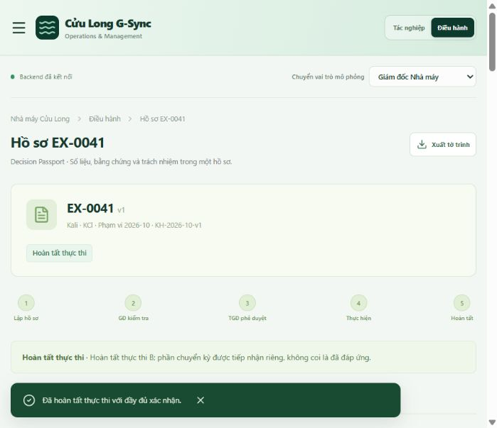
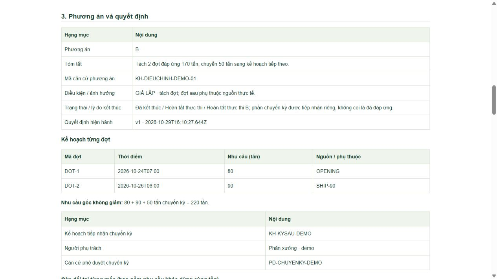

# Đối chiếu yêu cầu và nghiệm thu Governance v2

Ngày kiểm tra: **29/10/2026**. Mã nguồn chức năng: **a69670b**. Bộ chứng cứ đi kèm là dữ liệu giả lập, không phải pilot nhà máy.

## Kết quả

- **68/68** ca tự động: [unit-tests.tap](acceptance/unit-tests.tap); đầu vào, thay đổi và đáp án kỳ vọng nằm trong từng test cùng số thứ tự tại [engine.test.ts](../tests/engine.test.ts).
- TypeScript và production build: PASS. Không thay dependency hoặc bảng SQL; schemaVersion 2 nằm trong payload JSON.
- API/database/R2/report smoke: PASS ở lượt QA trước chốt cuối; mã xử lý tệp không thay đổi. API Governance bản cuối được kiểm tra riêng, không tải tệp: [api-final.json](acceptance/api-final.json).
- Qua UI bản cuối: A từ đầu vào → trình → trả lại → v2 → duyệt → thực nhận → Kho vận/Kế toán/QA → đóng. B từ đầu vào → 80/90/50 → Phân xưởng/KH-TM → duyệt có điều kiện → chặn nguồn chưa sẵn sàng → đủ nguồn → chặn thiếu chuyển kỳ → đủ liên kết → đóng. Đã mở tờ trình HTML và kiểm tra hai đợt, phần chuyển kỳ, cân đối, xác nhận.
- **Giới hạn tải tệp UI:** trình duyệt từ chối quyền tải file khi thử nút JSON. Đã dừng bước tải, không coi đây là PASS và không thử đường vòng. Chưa nghiệm thu thao tác lưu PDF qua hộp thoại hệ điều hành. Bộ tạo HTML/JSON vẫn được kiểm tra nội dung bằng test và dữ liệu đã có trước bước từ chối.
- **Gemini:** lượt nghiệm thu 29/10 chưa có key, nên các ca tự động dùng mock. Bổ sung ngày 30/10: thử trực tiếp bằng dữ liệu giả lập, gồm hồ sơ chưa lưu phương án và phương án B; `gemini-3.5-flash-lite` đều trả thành công, ba nhận định C1–C3 qua kiểm tra nguồn. Backend local báo đã nạp `.dev.vars`; khóa chỉ nằm ở cấu hình cục bộ bị Git bỏ qua. Đây là kiểm tra kết nối/demo, không phải đánh giá độ đúng nội dung, chi phí hay kết quả pilot.

## Ma trận yêu cầu → hiện thực → phép thử

| Yêu cầu | Hiện thực / kết quả kỳ vọng | Ca kiểm tra |
| --- | --- | --- |
| B1–B2 | Mảng đợt; lũy kế từng mốc; tính cả nhu cầu ngoài phạm vi dùng chung tồn; không chỉ số dư cuối | 15, 23–25 |
| B3 | Planned cho phép lập B có điều kiện; xác nhận DOT-2 cần bốn mốc và ba bộ phận xác nhận thực tế | 26, 27, 59; UI chặn nguồn |
| B4 | Carry có lượng, kế hoạch nhận, người, căn cứ; luôn 220 = 80 + 90 + 50 | 15, 20, 60 |
| B5–B7 | revised_plan đúng phiên bản/mã; execution đúng đợt; nguồn thực; liên kết carry_plan được GĐ xác nhận; thiếu mục nào chặn mục đó | 20, 26–29, 58–59; UI |
| B8 | Tóm tắt “tách hai đợt đáp ứng 170; chuyển 50”, không thay nhu cầu gốc 220 | 56; UI/tờ trình |
| D1 | includedQty + openingReceipt + openingCutoff; chỉ cộng phần còn lại; trùng lotId bị giữ | 10, 31, 65 |
| D2 | Căn cứ loại trùng + xác nhận Kho vận, không tự quảng bá dò giao nhau theo lô | 11, 32, 38 |
| D3 | Danh sách lệnh ngoài phạm vi; lệnh đang xét không được nằm trong A0 | 33 |
| D4 | Kế hoạch/định mức cần Phân xưởng xác nhận trên dấu dữ liệu, kèm người, thời điểm, căn cứ; mã mới không tự có hiệu lực | 38–39 |
| D5–D7 | Bốn mốc forecast/actual; sẵn sàng không trước QA; thiếu lịch chuyển unknown giữ lượng; giải thích nguồn chắc chắn/kế hoạch/loại trừ | 05–08, 40–41, 67; UI |
| V1–V2 | So dữ liệu trước/sau; lưu không đổi/đảo dòng không tăng phiên bản; urê không ảnh hưởng Kali; nhu cầu kỳ tương lai độc lập không hủy kỳ trước | 34–35, 61–63 |
| V3 | Quyết định đã ban hành giữ trong decisions/history; yêu cầu thay đổi có trường/lý do/phạm vi dừng; không dùng duyệt cũ để thực thi mới | 18, 36, 48 |
| V4 | Case theo nguyên liệu + scope, lưu needIds và mốc; chạy lại không trùng, kỳ khác có hồ sơ riêng; vẫn dùng chung nguồn lũy kế | 09, 13, 25, 37, 61–62 |
| V5 | Evidence version + executionId; dùng lại cần lý do và vai trò chuyên môn; không tự nâng chứng từ cũ | 29–30, 57, 64, 66 |
| R1–R4 | Bảy vai trò mô phỏng; năm xác nhận đầu vào riêng; A/B và thực nhận đúng bộ phận; backend kiểm tra vai trò; UI ghi rõ mô phỏng | 17, 38–39, 46, 66; UI A/B |
| AI1–AI2 | Thân tờ trình chỉ accepted/edited; Review_Log có trước/sau, DATA/RULE/LLM/FLOW, lý do, người, phiên bản | 42–43 |
| AI3–AI6 | Cấu hình và kết quả riêng; model phản hồi/token nếu có; gửi số khóa/lịch/phương án/nguồn; kiểm tra trường/nguồn; vẫn pending | 49–55, 68 (mock) + kiểm tra kết nối Gemini thật 30/10 |
| F1 | DATA_HOLD vẫn có risk_notice, người và hạn; không có số chính thức | 12, 44 |
| F2–F3 | close_verified cần cân đối mới đủ, căn cứ và GĐ; closeKind khác thực thi và không cộng KPI thực thi | 45; UI có nhánh riêng |
| F4 | A: đủ lượng, kịp hạn, order/receipt/release cùng version/receiptId, Kho vận/Kế toán/QA đúng lần nhận; đổi lượng/ngày hủy xác nhận | 19, 22, 30, 46, 64; UI A |
| UI1 | Chụp checklist và evidenceIds lúc trình; thêm muộn không hồi tố | 47 |
| UI2 | Số mốc cân đối và số hồ sơ tách đơn vị; approvedVersion phải khớp hiện hành; G-Score N/A | Kiểm tra dashboard / mã KPI |
| UI3–UI5 | HTML/PDF source và JSON cùng stages/carry/confirm/version; điền demo không tự xác nhận; mẫu, README, quy trình đã cập nhật | 56, 58; UI A/B và HTML |

Các test 01–22 giữ các nhóm hồi quy cũ nhưng cập nhật chốt mới; test B một lượng 170 tại một lịch đã được thay bằng kiểm thử hai đợt. Không coi con số “22” cũ là đã nghiệm thu B mới.

## Minh chứng và phiên bản





- [A cuối](screenshots/governance-v2-A-final.png): v2 sau trả lại.
- [B bị chặn nguồn trên bản cuối](screenshots/governance-v2-B-final-blocked.png).
- [ui-A.json](acceptance/ui-A.json) và [tờ trình A](acceptance/ui-A-report.html): ghi nhận lượt UI A trên build cuối **trước khi quyền tải JSON bị từ chối**.
- [ui-B.json](acceptance/ui-B.json) và [tờ trình B](acceptance/ui-B-report.html): dữ liệu lượt UI B đầu tiên; bản HTML được định dạng lại từ dữ liệu đã có. Sau chốt lịch/phiên bản, B đã được chạy lại đầy đủ qua UI trên bản cuối như ảnh; không tải JSON lượt sau vì giới hạn trình duyệt nêu trên.
- `recorded-case-replay.json`: kết quả kiểm lại điều kiện đóng của hai bộ dữ liệu UI đã ghi bằng engine cuối; không thay thế kiểm tra nút tải file.
- `manifest.json`: commit chức năng, SHA-256 file nguồn và chứng cứ. Commit tài liệu sau đó chỉ bổ sung nghiệm thu, không đổi logic ứng dụng.

Chạy lại kiểm tra local:

```powershell
npm.cmd test
npm.cmd run typecheck
npm.cmd run build
# Mở app tại 8787 bằng npm run start ở cửa sổ khác:
node tests/api-governance.mjs
```

Workflow quay demo: [quy trình.md](../quy%20tr%C3%ACnh.md). Giới hạn triển khai: [ARCHITECTURE.md](ARCHITECTURE.md).

## Ngoài phạm vi đúng checklist I

Chưa triển khai Power Automate/SharePoint, Excel/Python thực tế, Nano, OCR, tiêu hao theo mẻ, SLA/lịch làm việc tự động, G-Score/Precision/Recall thật, đăng nhập định danh doanh nghiệp hoặc đo tiết kiệm nhà máy. Bản web mô phỏng tiếp tục được ghi nhãn rõ, không tạo điểm hoặc kết quả pilot giả.
